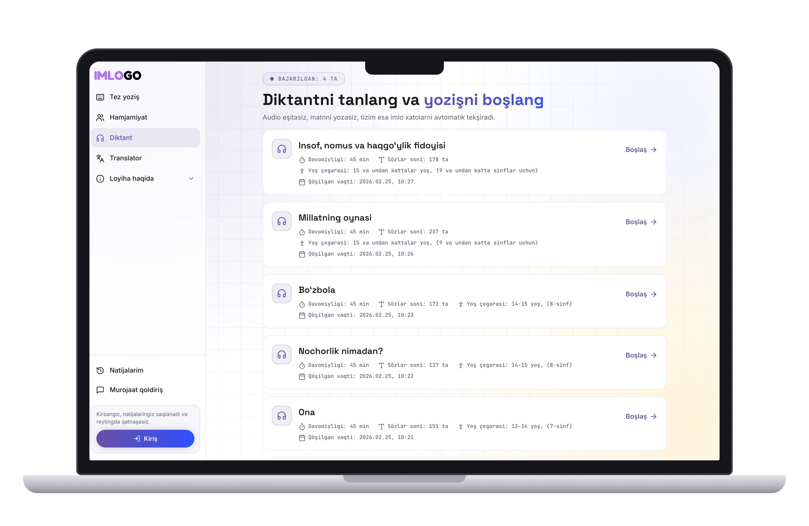

# 📘 Imlo Go — O‘zbek tilidagi Diktant App Landing Page



**Imlo Go** — bu o‘zbek tilida diktant yozishni, imlo xatolarni aniqlashni va o‘rganishni yangi bosqichga olib chiqadigan platformaning landing sahifasidir. Ushbu repo orqali siz platformaning marketing va taqdimot sahifasini topasiz.

👉 **Live demo**: [imlogo.uz](https://imlogo.uz)

---

## 🚀 Texnologiyalar

- ⚡ [Next.js 15](https://nextjs.org/)
- 🎨 [Tailwind CSS](https://tailwindcss.com/)
- 🌐 SEO uchun optimallashtirilgan meta taglar
- 💡 Minimalistik dizayn
- 📱 Responsive (mobil va desktop uchun mos)

---

## 📦 O‘rnatish

Loyihani o‘z kompyuteringizda ishga tushurish uchun quyidagi qadamlarni bajaring:

```bash
git clone https://github.com/your-username/imlogo-landing.git
cd imlogo-landing
npm install
npm run dev
````

So‘ngra oching: [http://localhost:3000](http://localhost:3000)

---

## ⚙️ Sozlash

Agar siz sahifadagi matnlar, ranglar yoki komponentlarni o‘zgartirmoqchi bo‘lsangiz:

* Bosh sahifa: `app/page.tsx`
* Stil: `tailwind.config.js`, `globals.css`
* Metadata: `app/layout.tsx`

Ranglar va brending uchun asosiy `primary color` loyihaga moslashtirilgan.

---

## 📂 Tuzilishi

```
.
├── app/                # Next.js routing + sahifalar
├── public/             # Rasmlar va ochiq fayllar
├── styles/             # Global stil va Tailwind sozlamalari
├── components/         # Qayta foydalaniladigan komponentlar
├── tailwind.config.js  # Tailwind konfiguratsiyasi
└── README.md           # Hozir o‘qiyotgan fayl
```

---

## 📄 Litsenziya

Ushbu loyiha **MIT litsenziyasi** asosida ochiq manba sifatida taqdim etiladi. Istagancha foydalaning, o‘zgartiring va ulashing.

---

## 🤝 Hamkorlik

Xatolik topsangiz yoki yaxshilash g‘oyalaringiz bo‘lsa, **Pull Request** yuboring yoki **Issue** oching. Hamma fikrlar e'tiborga olinadi.

---

> Yaratuvchi: [@futzone](https://github.com/futzone)
> Diktant platformasi: [Imlo Go](https://imlogo.uz)
> Aloqa uchun: [Telegram](https://t.me/Qahor0v_bot)
> Til: O‘zbek tili


 
